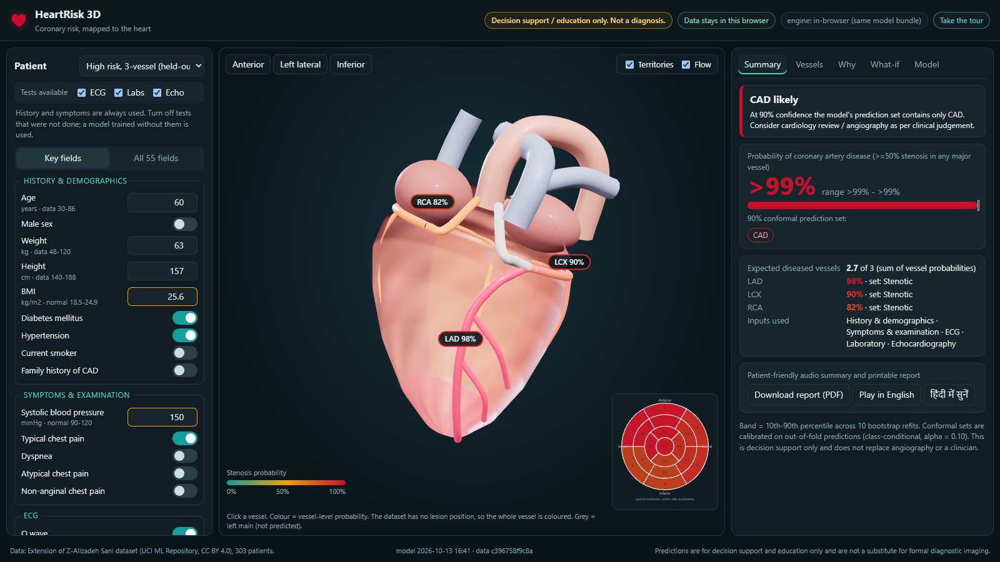

# HeartRisk 3D

**Multimodal AI Hackathon 2026 · Track A: Cardiovascular Risk Visualization & Prediction**

HeartRisk 3D predicts coronary artery disease (CAD) and stenosis of the three main coronary arteries (LAD, LCX, RCA) from routine clinical data, then shows the result on an interactive 3D heart: each artery is coloured by its predicted probability, and every number comes with an explanation, an uncertainty range and a "can the model be trusted here?" check.

> **Decision support / education only.** Not a diagnosis and not a substitute for angiography or a clinician.



- **Live demo (no install):** https://mg782469.github.io/heartrisk3d/ *(runs entirely in your browser)*
- **Demo video:** *add YouTube link*
- **Documentation (6 pages):** [docs/DOCUMENTATION.pdf](docs/DOCUMENTATION.pdf)

## What it does

| | |
|---|---|
| **4 predictions** | CAD, LAD, LCX and RCA stenosis (>=50%), calibrated probabilities |
| **3D heart** | Procedural heart with anatomically placed LAD / LCX / RCA; colour = probability; rotate, zoom, click a vessel; camera presets; flow particles slow down as risk rises; optional typical-territory shading |
| **AHA 17-segment bullseye** | Standard coronary territories shaded by vessel risk (labelled as typical, not a lesion map) |
| **Why** | Per-patient SHAP (exact for the linear models, TreeSHAP for boosted trees) and which *test type* (history, symptoms, ECG, labs, echo) drove the prediction |
| **Uncertainty** | Bootstrap probability band + 90% **conformal prediction sets** -> "CAD likely", "CAD unlikely" or "Uncertain: refer" |
| **Tests available switch** | No echo or labs at a primary health centre? Turn them off and a model trained without them is used (multimodal ablation) |
| **What-if** | Model sensitivity for modifiable inputs, clearly labelled as *not* a treatment effect |
| **Safety** | Out-of-distribution warning (range + Mahalanobis), coherence check between CAD and vessel predictions, disclaimer on every screen |
| **Report and tour** | One-click printable report with a 3D snapshot; 4-step guided tour on first visit |
| **Privacy** | Runs on 127.0.0.1 or fully in the browser; nothing is stored or sent anywhere |

## Results (held-out test, n = 61, 95% bootstrap CI)

| Target | ROC-AUC (test) | CV ROC-AUC (n = 242, 5x5) | Deployed model |
|---|---|---|---|
| CAD | 0.853 [0.76-0.94] | 0.946 ± 0.038 | Elastic-net logistic regression |
| LAD | 0.791 [0.67-0.89] | 0.853 ± 0.057 | Elastic-net logistic regression |
| LCX | 0.756 [0.62-0.87] | 0.728 ± 0.066 | Gradient boosting |
| RCA | 0.677 [0.53-0.82] | 0.743 ± 0.074 | Elastic-net logistic regression |

Full metrics (accuracy, precision, recall, F1, PR-AUC, Brier, calibration, decision curve, conformal coverage, subgroups) are in the app's **Model** tab and in `artifacts/reports/`.

## Run it

```bash
pip install -r requirements.txt
python app/server.py          # http://127.0.0.1:8000  (Windows: double-click run.bat)
```

The trained models are included in `artifacts/`. To retrain from scratch (5-30 minutes depending on the CPU):

```bash
python ml/train.py
python -m pytest -q           # 8 checks: leakage, anatomy mapping, API, Python<->JS parity, sanity
```

No Python? Open `web/index.html` through any static server (or the live link): the same model bundle runs in the browser.

## How it works

```
UCI dataset (303) -> leakage guard -> 80/20 split -> 4 families x repeated 5x5 CV -> 1-SE rule
  -> Platt calibration (out-of-fold) -> Mondrian conformal (alpha 0.10) -> 10 bootstrap refits
  -> 8 modality sets (all combinations of ECG / labs / echo)
  -> model_bundle.json -> Flask API (scikit-learn + SHAP)  |  browser engine (JS, parity-tested)
  -> Three.js heart + dashboard
```

| Path | What |
|---|---|
| `ml/features.py` | Feature encoding, modality groups, normal ranges, leakage list |
| `ml/train.py` | Training, validation, calibration, conformal, reports, export |
| `app/server.py` | Flask API (`/api/predict`, `/api/whatif`, `/api/metrics`, ...) |
| `web/js/engine.js` | In-browser inference (same bundle; max difference vs Python 5e-11) |
| `web/js/heart.js` | Procedural 3D heart and coronary arteries |
| `web/js/anatomy.js` | Model output -> 3D structure registry (single source of truth) |
| `tests/` | pytest + Node parity test |

## Design decisions worth knowing

- **Targets are never inputs.** LAD, LCX, RCA and Cath are excluded and a test enforces it. Scaling is fitted inside each CV fold.
- **Region RWMA is not a location.** It is a 0-4 score, so it is used as a model input only and is never drawn onto the heart.
- **No fake lesion positions.** The data says *whether* a vessel is stenotic, not *where*, so the whole vessel is coloured.
- **Simplest model that is as good.** Four families are compared; the deployed one is the simplest within one standard error of the best.
- **Negative results are kept.** A classifier chain for LCX/RCA did not improve CV AUC, so it is not deployed (`ml/experiment_chain.py`).
- **What-if is not causal.** In this dataset some "healthy" changes (e.g. lower BMI) raise the model's estimate, a confounding effect; the app says so.

## Limitations

Single-centre dataset of 303 patients, no external validation; test-set estimates are noisy (see CIs). Conformal coverage on the test set (82-85%) is below the 90% target but within sampling error for n = 61. The 3D heart is illustrative, not patient-specific anatomy. See [MODEL_CARD.md](MODEL_CARD.md).

## Credits

Dataset: *Extension of Z-Alizadeh Sani dataset*, UCI Machine Learning Repository (CC BY 4.0). Three.js (MIT). AHA 17-segment model: Cerqueira et al., *Circulation* 2002.

Built by Manas Girdhar (BIT Mesra) for the Multimodal AI Hackathon 2026 (KamandPrompt, IIT Mandi).
